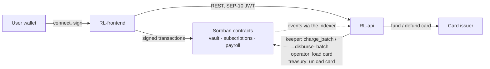

# Rubbi frontend

[Rubbi](https://github.com/RubbiLabs) is a payment automation platform for users in Nigeria: a USDC balance on Stellar (the Rubbi wallet), a virtual card loaded from it, recurring subscriptions paid from the user's own wallet, and recurring payroll from an employer escrow. This repository is the Next.js 16 web app: wallet connection with Stellar Wallets Kit, SEP-10 sign-in, the wallet and card pages, subscriptions and payroll. It signs every contract call in the user's own wallet and talks to the Rubbi API over REST with a SEP-10 JWT. The product runs on **Stellar testnet** today; cards come from a mock issuer and carry a MOCK badge.

## How the Rubbi repositories fit together

Rubbi is three repositories under the [RubbiLabs](https://github.com/RubbiLabs) organisation. Nothing moves money except a transaction signed by the user's own wallet or by one of the backend's narrowly scoped keys.

| Repository | Role | Talks to |
|---|---|---|
| [RL-smart-contracts](https://github.com/RubbiLabs/RL-smart-contracts) | Soroban contracts on Stellar: vault (Rubbi wallet and card funding), subscriptions (allowance-based recurring payments), payroll (employer escrow) | USDC on Stellar; called by users' wallets and by the backend keys |
| [RL-api](https://github.com/RubbiLabs/RL-api) | Backend: SEP-10 sign-in, event indexer that mirrors contract events into Postgres, keeper that runs due charges and payroll, card loading and unloading, card issuer adapter | Stellar RPC and the three contracts; serves the frontend over REST |
| **RL-frontend (this repository)** | Next.js web app: wallet connection (Stellar Wallets Kit), sign-in, wallet and card, subscriptions, payroll | users' wallets (signing), the contracts (direct calls), the API (REST + JWT) |



- **A user action.** A deposit is signed in the user's wallet and lands in the vault contract; the indexer sees the `deposit` event and records it; the app shows the new balance.
- **A recurring payment.** When a subscription or salary falls due, the keeper calls `charge_batch` or `disburse_batch`. Anyone could make that call, but nobody can charge early or twice: the contracts are time-gated and pay exactly one period.
- **Where to start.** The contracts if you write Rust/Soroban, the API for a TypeScript backend, the frontend for React.

Other repositories: [RL-smart-contracts](https://github.com/RubbiLabs/RL-smart-contracts) and [RL-api](https://github.com/RubbiLabs/RL-api). Organisation: https://github.com/RubbiLabs.

No private key ever reaches the browser. Every `NEXT_PUBLIC_*` value is public (ids and URLs).

## Setup

```bash
npm ci
cp .env.example .env.local      # set NEXT_PUBLIC_API_URL
npm run dev                      # http://localhost:3001
```

Ports: the frontend runs on **3001** (`dev` and `start` scripts) and the API on **3000** (`NEXT_PUBLIC_API_URL=http://localhost:3000/api/v1`). The API must list this app's origin in its `CORS_ORIGINS` (default `http://localhost:3001`, see `RL-api/.env.example`).

| Variable | Required | Notes |
|---|---|---|
| `NEXT_PUBLIC_API_URL` | yes | API base URL including `/api/v1` |
| `NEXT_PUBLIC_STELLAR_NETWORK`, `NEXT_PUBLIC_STELLAR_RPC_URL`, `NEXT_PUBLIC_STELLAR_NETWORK_PASSPHRASE` | no | override `GET /stellar/config` |
| `NEXT_PUBLIC_USDC_SAC_ID`, `NEXT_PUBLIC_VAULT_CONTRACT_ID`, `NEXT_PUBLIC_SUBSCRIPTIONS_CONTRACT_ID`, `NEXT_PUBLIC_PAYROLL_CONTRACT_ID` | no | override the ids from `GET /stellar/config` |
| `NEXT_PUBLIC_USDC_ISSUER` | no | classic USDC issuer for the trustline; resolved from the SAC's `name()` when unset |

Checks: `npm run lint`, `npm run type-check`, `npm run build`, `npm run check:errors` (compares `lib/stellar/errors.ts` with the contracts' `errors.rs`; skipped when `../RL-smart-contracts` is absent). CI (`.github/workflows/ci.yml`) runs the same four on every push and pull request.

## Flows

| Flow | Where | How |
|---|---|---|
| Sign-in | `/onboarding` | connect (Stellar Wallets Kit) → `GET /auth/challenge` → wallet signs the SEP-10 challenge → `POST /auth/token` → JWT kept in memory and `sessionStorage` |
| Username and card | `/onboarding` | `POST /users/username` creates the card; cards from the mock issuer carry a visible **MOCK** badge |
| Trustline | `/dashboard/wallet` | account and USDC trustline read via RPC `getLedgerEntries`; one-click `changeTrust`; Friendbot and Circle faucet links on testnet |
| Rubbi wallet | `/dashboard/wallet` | `vault.deposit` / `vault.withdraw` signed by the wallet; API mirror shown next to the on-chain balance |
| Card | `/dashboard/card` | `POST /cards/load` / `POST /cards/unload`, movements polled every 5 s while `PENDING`, `SETTLED` or `PENDING_TREASURY` |
| Subscriptions | `/dashboard/subscriptions` | step 1 SAC `approve(amount × N periods, expiration ledger)` (choice of 1, 3, 6 or 12 periods, replacement semantics), step 2 `subscribe`; shared allowance health warnings (`ok`, `last_payment_covered`, `insufficient_for_next_charge`, `expires_before_next_due`, `expired`) and one-click top-up banner; `pause_subscription` / `resume_subscription` / `cancel_subscription` |
| Payroll | `/dashboard/payroll` | `fund` / `withdraw_escrow`, `create_schedules` (≤ 25 per transaction, validated client-side and atomically on-chain), `pause_schedule` / `resume_schedule` / `cancel_schedule`, "Pay due now" = `disburse_batch` |
| Dashboard | `/dashboard` | `GET /dashboard/stats` only |

## Code map

| Path | Purpose |
|---|---|
| `lib/stellar/config.ts` | network config: `GET /stellar/config` merged with `NEXT_PUBLIC_*` overrides; explorer and faucet URLs |
| `lib/stellar/amount.ts` | 7-decimal USDC helpers on `bigint`/strings (no floating-point money math) |
| `lib/stellar/invoke.ts` | build → simulate → assemble → wallet sign → submit → poll; `StellarTxError` with user-facing messages |
| `lib/stellar/errors.ts` | error code tables for the vault, subscriptions, payroll and the USDC SAC |
| `lib/stellar/{vault,subscriptions,payroll,sac,account}.ts` | typed contract calls and ledger reads |
| `lib/subscriptions/allowance.ts` | shared SAC allowance health computation and top-up period calculation |
| `lib/stellar/walletKit.ts` | lazy, client-only Stellar Wallets Kit initialisation (Freighter first) |
| `context/StellarWalletContext.tsx` | connect / disconnect / network check / `signTransaction` / SEP-10 session |
| `lib/api.ts`, `types/api.ts` | typed API client and response types |
| `hooks/useApi.ts`, `hooks/useChain.ts`, `hooks/useStellarTx.ts` | React Query hooks for the API and the ledger; transaction runner with the status modal |

## Amounts

Contract amounts are `i128` stroops (USDC has 7 decimals). The UI parses user input with a strict decimal regex, converts with `bigint`, and formats back with string arithmetic. API amounts are decimal strings and are parsed the same way.

## Contributing via Drips Wave

Rubbi takes part in the Stellar Wave programme on [Drips](https://www.drips.network/): issues labelled **`Stellar Wave`** are scoped, paid tasks open to outside contributors. Each one states its Context, Scope, Acceptance criteria and Complexity (Trivial / Medium / High). Comment on an issue to claim it, wait for a maintainer to assign it, then open a pull request that closes it with every acceptance criterion met and all checks green. One claimed issue per contributor at a time.

[CONTRIBUTING.md](CONTRIBUTING.md) has the setup, the branch and Conventional Commit rules, the pull request checklist, test expectations and the AI-assistance policy (tools are fine; you must understand, test and be able to explain every line, and low-effort generated pull requests are closed). Everyone taking part follows the [Code of Conduct](CODE_OF_CONDUCT.md). Report security issues privately per [SECURITY.md](SECURITY.md), never in a public issue.

Related repositories: [RL-smart-contracts](https://github.com/RubbiLabs/RL-smart-contracts) (Soroban contracts) and [RL-api](https://github.com/RubbiLabs/RL-api) (backend) use the same conventions and have their own Wave issues.

## License

[MIT](LICENSE).
